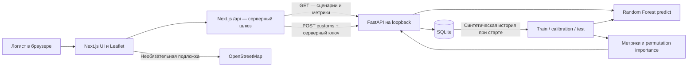

# Архитектура CaspiFlow

Существующий Next.js + FastAPI + SQLite проект расширен для демонстрации кейса 2. Три результата исходного задания сопоставлены с работающими функциями в [CASE_REQUIREMENTS.md](CASE_REQUIREMENTS.md). Новый проект не создавался.

## Компоненты и ответственность

- `frontend/app/page.tsx`: выбранный груз, путь и запрошенный сценарий; отмена устаревших fetch через AbortController; успешный snapshot показывается согласованно. Ошибка запроса не превращает старый прогноз в новый: интерфейс сохраняет применённый сценарий и предлагает повтор.
- `PredictionInsights.tsx`: сравнение времени и ETA, глобальная важность признаков, реальные входы прогноза, MAE/RMSE/R² и оговорки.
- `TransitMap.tsx`: семь портов, три пути, прогресс по всей ломаной, маркеры выбора грузов и условные опасные морские участки. Погодный риск — правило интерфейса по storm×exposure, не выход классификатора навигационной безопасности. При недоступности OSM остаётся локальный контур Каспия и векторные маршруты с уведомлением.
- Next.js Route Handler: allowlist путей, контроль Origin POST, ограничение UTF-8 тела 8192 байт, тайм-аут 15 секунд, no-store. Сервисный ключ добавляется сервером и не передаётся клиенту.
- `backend/main.py`: схема SQLite, API, сценарные признаки, арифметика CO₂ и ETA, валидация таможни.
- `backend/ml.py`: воспроизводимый Random Forest; отдельные train/calibration/test; калибровка диапазона; измеренные метрики и permutation importance. Обучение и объяснения выполняются при старте, inference — по сценарным запросам.

## API

| Метод и путь FastAPI | Назначение | Доступ |
|---|---|---|
| GET `/health` | Готовность сервиса после обучения | Локальный, без ключа |
| GET `/dashboard?storm=0&port_load=80` | Четыре груза, порты, сценарии и метрики | Локальный, без ключа |
| GET `/shipments/CF-2026-0841?storm=100` | Один груз и три альтернативы | Локальный, без ключа |
| GET `/model` | Метрики, конфигурация, разбиение и факторы | Локальный, без ключа |
| POST `/customs` | Демо-заявка pre-clearance | `X-API-Key` между сервисами |

Браузер использует соответствующие `/api/*` Next.js. storm — целое 0–100; необязательный port_load — целое 30–99, базовая нагрузка для всех альтернатив. Без override берётся база каждого маршрута. Нагрузка после добавки сценария ограничена 99%. Погода масштабируется по фиксированной экспозиции пути: море сильнее реагирует на каспийский шторм, суша слабее.

Каждый маршрут возвращает baseline без шторма при той же базовой нагрузке, текущее предсказание, interval, ETA, delay_change_hours, risk_level, hazard_legs и prediction с входами, версией модели и признаком выхода за train-диапазон. Два состояния проходят настоящий estimator.predict. Длина — сумма segment.km; время — hours + delay_hours; CO₂ — сумма weight_t × km × factor, округлённая до кг. Масса не входит в прогноз задержки.

## Хранение и время

SQLite содержит `ports`, `shipments`, `history`, `customs`. Сохраняются демонстрационные данные и заявки. По умолчанию база `backend/caspiflow.sqlite`; для изоляции можно задать абсолютный `CASPIFLOW_DB_PATH`. Тесты backend используют временную базу.

Snapshot прогресса фиксирован. Момент демонстрационной отправки выводится из сохранённых updated_at, progress и плановой длительности текущего маршрута; это модельный якорь, не событие реальной отправки. ETA каждого варианта = этот же якорь + полная длительность варианта. Поэтому после/до шторма сравниваются при одном отправлении, без дрейфа часов между запросами. Хранение и API — timezone-aware UTC; отображение — Europe/Moscow с маркировкой МСК. Сброс не изменяет записи грузов.

## Таможня и безопасность

Pydantic запрещает неизвестные поля, лишние пробелы нормализуются, код ТН ВЭД допускает десять ASCII-цифр, стоимость положительная и конечная, список стран ограничен. Ключ сравнивается constant-time. SQL параметризован. `BEGIN IMMEDIATE` сериализует проверку и запись заявки: параллельные одинаковые повторы получают один ID. Уникальность shipment_id сохраняется. Повтор того же нормализованного payload идемпотентен; другой payload того же груза даёт 409.

SHA-256 фиксирует содержимое заявки, но не является электронной подписью, распределённым реестром или защитой от администратора БД. Прототип демонстрирует разрешённый кейсом путь защищённых API; государственных систем нет. UI прямо указывает демонстрационный статус и отсутствие юридической силы. Пользовательская авторизация и роли пока отсутствуют: браузер через локальный шлюз имеет право подать любую демо-заявку. Loopback-режим нельзя принимать за production access control.

Секрет `.env`, SQLite, venv, node_modules и runtime не коммитятся. Секреты не нужны для скриншотов, тестового отчёта или ML-аудита. Публичная публикация не выполнялась.

## Воспроизведение и эксплуатация на финале

`./scripts/dev.sh` создаёт локальный сервисный ключ при отсутствии .env и запускает оба сервиса на 127.0.0.1. Для репетиции собранной версии используйте `./scripts/demo.sh`: сборка frontend, запуск FastAPI, ожидание health и Next.js start. Не запускайте два комплекта серверов на одних портах. Ctrl+C останавливает запущенные скриптом процессы. Проверки описаны в README и FINAL_REPORT.

## За пределами MVP

Реальные AIS/GPS, погодный провайдер, TOS портов, ЭП/таможенные песочницы, транспортный граф и расписания, графовая СУБД, стоимость и вместимость путей, роли, TLS, rate limiting, резервные копии, мониторинг и промышленная БД — следующие этапы. Отдельный blockchain для MVP не нужен. Платные сервисы не подключались.
